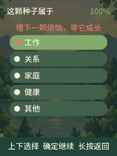

<p align="right">
  <a href="README.md">English</a> · <strong>简体中文</strong>
</p>

# 烦恼种子

> 说出来，埋在土里，等它结果开花。

<p align="center">
  
</p>

烦恼种子把 AI Passport 变成一座私密、完全离线的声音花园。说出的烦恼会成为一颗种子；之后每一次记录进展，都是一次浇灌，推动它经历五个成长阶段；当用户确认旧烦恼已经解决，这段经历会成为留在花园里的果实。

应用不会转写、自动分类、诊断、同步或上传录音。它是一种整理和回望心事的方式，不承诺所有烦恼都会得到解决。

## 体验流程

1. 在种子园长按确定，开始播种。
2. 选择工作、关系、家庭、健康或其他。
3. 录制最长 60 秒的声音。
4. 之后可以重新听最初的烦恼、听最近的进展，或记录新的进展。
5. 每次进展录音都会推动种子经历种子、发芽、幼苗和成树阶段。
6. 用户确认问题已经解决后，种子会结果，并播放庆祝旋律。

花园最多保存 12 颗种子；每颗种子包含 1 条初始录音和最多 5 条进展录音。

## 界面

| 空花园 | 分类选择 | 正在倾诉 | 播种完成 |
| --- | --- | --- | --- |
|  |  |  |  |

## 按键操作

| 页面 | 上／下 | 单击确定 | 长按确定 |
| --- | --- | --- | --- |
| 种子园 | 选择种子 | 查看选中的种子 | 播种新种子 |
| 分类页 | 选择分类 | 继续 | 返回 |
| 录音待机 | 无操作 | 开始录音 | 返回 |
| 正在录音 | 无操作 | 完成录音 | 取消 |
| 种子详情 | 选择动作 | 执行动作 | 返回种子园 |
| 确认页 | 无操作 | 确认 | 取消 |

播放录音时单击确定可以停止。按键操作、播种、倾诉录音和结果完成分别提供声音反馈；结果完成会播放更完整的庆祝旋律。

## 当前美术范围

当前公开体验只启用一套经过集中完善的像素花园主题。背景、成长阶段图和操作图标采用独立图层，方便调整布局，而不影响状态模型。

浪漫水彩、微缩写实、东方水墨和星空梦境素材已经作为未来主题材料入库，但当前固件刻意关闭主题切换，暂时不能把它们描述为用户可选功能。

## 隐私与存储

- 花园元数据保存在 NVS 中，包含版本和 CRC 校验。
- 录音只保存在设备的 5 MiB `worryfs` SPIFFS 分区。
- 音频采用 8 kHz 单声道 IMA ADPCM；60 秒录音约 240 KB。
- 新录音先写入临时文件，再通过原子改名完成保存。
- 应用不启用 Wi-Fi 或蓝牙。
- 当前没有录音导出或备份功能，重要录音不应只保存在设备中。

## 构建与合并固件

使用 ESP-IDF 5.5.3：

```sh
./tools/validate.sh --static
./tools/validate.sh --firmware
./tools/validate.sh
```

合并固件输出为 `build/FoloToy-AI-Passport-full.bin`，从 `0x0` 写入。刷机前必须获得设备所有者确认。合并刷写会写入 bootloader、分区表和应用；如果旧分区布局不兼容，既有数据可能不可读，录音分区也可能在挂载失败时被格式化。

## USB 截屏与模拟按键

固件通过本机 USB Serial/JTAG 提供开发调试命令：

```sh
python3 tools/capture_worry_seed_screenshot.py \
  --port /dev/cu.usbmodemXXXX --output /tmp/worry-seed.png

python3 tools/control_worry_seed.py --port /dev/cu.usbmodemXXXX up
python3 tools/control_worry_seed.py --port /dev/cu.usbmodemXXXX down
python3 tools/control_worry_seed.py --port /dev/cu.usbmodemXXXX ok
python3 tools/control_worry_seed.py --port /dev/cu.usbmodemXXXX ok --long
```

这些工具与实体按键共用应用事件队列，可以验证页面渲染和应用逻辑，但不能验证 LCD 电气链路、ADC 电阻梯、实体开关接触、扬声器实际音量或麦克风质量。详见[烦恼种子 USB 截屏与调试控制](docs/development/engineering/worry-seed-screenshot.zh_CN.md)。

## 验证与项目资料

成功构建、成功写入、USB 截图和模拟按键分别代表不同证据。完整真机验收仍需要在目标设备上检查实体按键、屏幕、麦克风、扬声器音量、重启持久化和存储行为。

- [当前交接与验收记录](docs/reference/foxmuldery/worry-seed-handoff.zh_CN.md)
- [产品与官网文案说明](docs/brand/worry-seed-website-product-brief.zh_CN.md)
- [AI Passport 硬件开发指南](docs/hardware-design/AI_HARDWARE_DEVELOPMENT_GUIDE.zh_CN.md)
- [仓库文档索引](docs/README.zh_CN.md)
